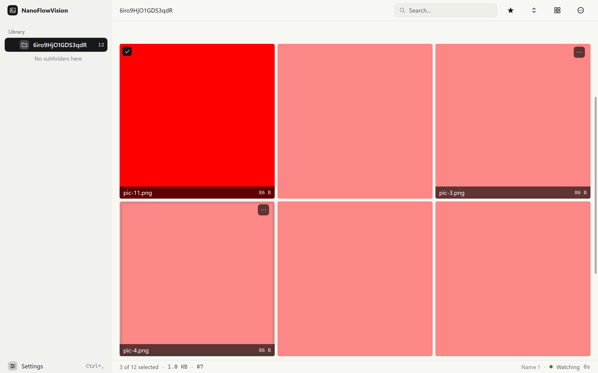
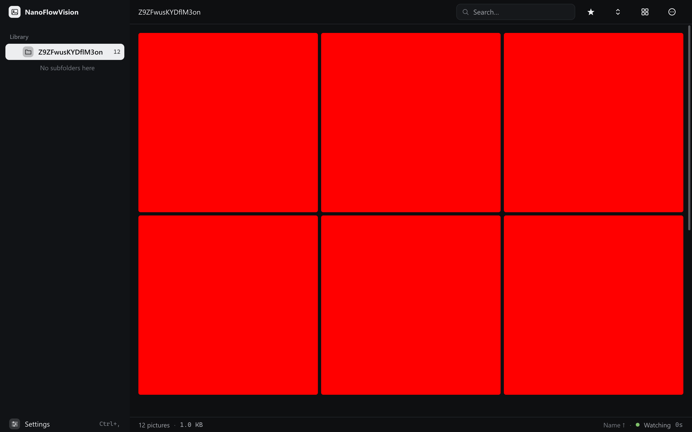
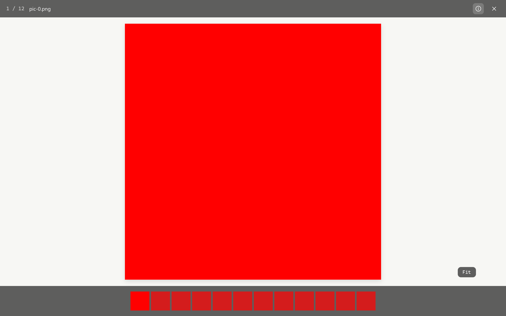

<div align="center">
  <br><br>
</div>

# NanoFlowVision

[](https://github.com/tiramission/NanoFlowVision/actions/workflows/ci.yml)

一个用 [nanoui](https://github.com/justrach/nanoui) 写的图片浏览器：左边是文件夹树，
右边是按列排布的瀑布流画廊。Zig 0.17，一个代码库画出三个平台（Windows 用自己的渲染器，
macOS 用 Metal）。

原项目是 [netdcy/FlowVision](https://github.com/netdcy/FlowVision)（macOS 上的 Swift/AppKit
瀑布流图片浏览器，GPL）。本项目是它的纯 Zig 重写。





## 有什么

- **导航栏**：根文件夹与子文件夹的树，带每个文件夹的照片数；右缘可拖宽（200–360）。
  点上方标记回到根，`⌘B` 折叠。
- **瀑布流画廊**：每张照片放进最矮的一列，高度按宽高比算。宽高比只读文件头，
  不解码像素，一万个文件也立刻成形；只有视口内的图块会被构建。
- **三档密度**：小 / 中 / 大（目标行高 128 / 256 / 512），菜单里切，带 toast 回声。
- **挑拣**：单击选中、`⌘` 加选、`⇧` 连选、空白处框选、`⌘A` 全选；方向键走网格，
  光标始终可见；`0`–`5` 批量评分，`⌫` 批量移入回收站（多张先确认），`F2` 重命名。
- **排序与搜索**：名称/日期/大小/像素/星级，升序/降序；`⌘F` 聚焦搜索，即时过滤；
  状态条常驻显示排序键与方向、当前游标位置。星级筛选（★≥N）只让够格的留在墙上。
- **大图**：双击或空格打开。顶部条有序号、文件名、可点星级、全屏、信息与关闭；
  底部胶片条按照片比例、当前项加环；滚轮以指针为锚缩放，`Z` 适应 ⇄ 1:1，`F` 铺满 ⇄ 1:1；可拖拽平移；
  左下信息卡片显示相机、时间、光圈快门 ISO 焦距，可收起；`I` 折叠，`Z` 缩放。
- **星级与标签写进文件**：`1`–`5` 打星、`t` 加标签，以 XMP 写回照片文件本身——
  文件挪到哪儿评分跟到哪儿，Lightroom 也认。
- **文件操作**：复制、粘贴、重命名、移到回收站（系统回收站，可还原）、在文件夹中显示。
- **磁盘监视**：文件夹里增删照片，画廊自己更新。
- **中英界面、深浅两主题**（可跟随系统），设置即时生效并持久化；窗口位置与大小下次回来还在。
- **状态齐全**：空目录、无匹配、测量中（骨架墙）、解码失败、目录不可读各有自己的样子与出口。

界面设计与组件规格在 [docs/design.md](docs/design.md)；还没做的事在 [ROADMAP.md](ROADMAP.md)。

## 快捷键

`⌘` 在 Windows/Linux 上是 `Ctrl`。应用内 `⌘/` 打开完整键盘一览（设置面板页脚同入口）。

| 键 | 作用 |
|---|---|
| `⌘O` / `⌘,` | 打开目录 / 设置 |
| `⌘B` / `⌘D` | 折叠导航栏 / 外观循环 |
| `⌘F` | 聚焦搜索 |
| `←` `→` `↑` `↓` | 走网格（到大图里则是上一张/下一张） |
| `Space` / `Enter` | 打开大图；大图里 `Space` 关闭 |
| `F11` | 全屏看图（macOS 也可 `⌃⌘F`） |
| `0`–`5` | 评分（`0` 清除） |
| `⌫` / `Delete` | 移入回收站（多张先确认） |
| `F2` | 重命名 |
| `⌘C` / `⌘V` | 复制 / 粘贴文件 |
| `⌘A` / `Esc` | 全选 / 放开选择（逐层关闭浮层） |
| `T` / `I` / `Z` / `F` | 标签 / 信息块 / 适应 ⇄ 1:1 / 铺满 ⇄ 1:1（大图） |
| `⌘⇧R` / `⌘↩` | 在文件夹中显示 / 用系统程序打开 |

## 跑起来

需要 Zig 0.17.0。

```sh
zig build                                  # 编译（默认 ReleaseFast）
zig build test                             # 测试（离屏渲染，不弹窗）
zig-out/bin/nanoflowvision.exe             # 打开窗口
zig-out/bin/nanoflowvision.exe D:\Photos   # 直接看某个文件夹
```

界面是用 CPU 画的，大图缩放一帧要光栅化二百多万像素（1280×800 @2x）：`zig build` 因此默认
`ReleaseFast`（未优化时慢约 5 倍，缩放会像幻灯片）。调试用 `-Doptimize=Debug`，
测试用 `-Dtest-optimize=ReleaseFast` 或 `-Dtest-optimize=Debug`。

不装 `nui` 也能做离屏检查：

```sh
zig-out/bin/nanoflowvision.exe D:\Photos --nanoui-snapshot=shot.png --nanoui-wait=2
zig-out/bin/nanoflowvision.exe D:\Photos --nanoui-dark --nanoui-snapshot=shot-dark.png
```

`tests_shots.zig` 会把界面渲染成 `docs/redesign/shots/` 里的快照（`src/shots.zig`
压缩写入，每张几百 KB）。

## 它是怎么做的

| 模块 | 做什么 |
|---|---|
| `src/scan.zig` | 读文件夹：子文件夹与图片 |
| `src/decode.zig` | 只读文件头拿宽高；解码成 BGRA 预乘像素，EXIF 方向在这里收口 |
| `src/wic.zig` / `src/imageio.zig` | Windows / macOS 的系统解码器：边解码边缩放 |
| `src/masonry.zig` | 算每张照片的位置：最矮的一列先放 |
| `src/thumbs.zig` | 缩略图缓存 + 工作线程池 |
| `src/exif.zig` / `src/xmp.zig` | EXIF 解析；星级与标签的 XMP 写回（临时文件 + 原子替换） |
| `src/select.zig` | 选择集合、游标、框选 |
| `src/shell.zig` / `src/rail.zig` | 命令栏（面包屑、搜索、菜单、评分筛选）；导航栏 |
| `src/gallery.zig` / `src/tile.zig` | 网格、滚动、空态、骨架墙、键盘；单张照片的角标 |
| `src/large.zig` / `src/filmstrip.zig` | 大图：顶部条、缩放平移、信息卡片、胶片条 |
| `src/statusbar.zig` | 计数、重量、游标位置、排序状态、监视点、测量进度 |
| `src/theme.zig` / `src/i18n.zig` / `src/config.zig` | 两套中性主题与对比度测试；双语；设置文件 |
| `src/app.zig` | 状态与视图：树、浮层、帧编排 |

三个关键决定：

1. **不走 nanoui 的图集，用 `ui.texture` 自己传像素。** 图集会把图限制在 1024 边长，
   满了还会清空重排；`ui.texture` 直接吃 BGRA，没有这些限制。
2. **布局是解析算出来的。** 宽高比在布局前已知，任意一张的位置能直接算出来，
   视口外的照片一个都不构建。
3. **大图不整幅进内存。** 系统解码器在解码时缩放；只有读不了的文件才整读、由
   [zigimg](https://github.com/zigimg/zigimg) 出缩略图。

## 依赖与协议

[nanoui](https://github.com/justrach/nanoui) v0.6.4（UI 框架）、
[zigimg](https://github.com/zigimg/zigimg)（纯 Zig 解码）、
[nfd-zig](https://github.com/fabioarnold/nfd-zig)（系统目录对话框）。

三者都是 MIT；本项目尚未选定协议。
