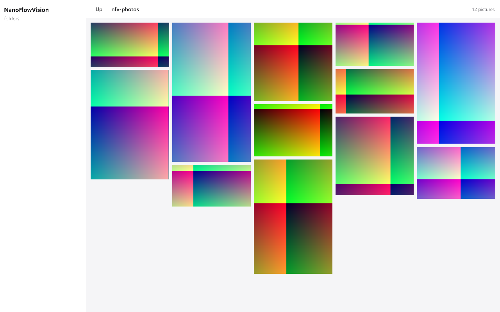

# NanoFlowVision

一个用 [nanoui](https://github.com/justrach/nanoui) 写的图片浏览器：左边是文件夹树，右边是按列排布的瀑布流画廊。

原项目是 [netdcy/FlowVision](https://github.com/netdcy/FlowVision)（macOS 上的 Swift/AppKit 瀑布流图片浏览器，GPL）。本项目用 Zig 0.17 + nanoui 重写，换来跨平台（Windows / Linux / macOS）与更小的体积。



## 现在有的东西

- **左侧文件夹树**：点开一个文件夹，它的子文件夹就在下面展开。
- **瀑布流画廊**：每张照片放进当前最矮的那一列，高度按原图宽高比算。
- **后台解码**：文件大小只读文件头得到，布局立刻成形；缩略图由 4 个工作线程解码，界面不卡。
- **双击看大图**：整张图放大到窗口大小，Esc 或点击返回。
- **虚拟化**：只构建视口内的照片，一万个文件和十个一样快。

## 跑起来

需要 Zig 0.17.0。

```sh
zig build                                  # 编译
zig build test                             # 测试（离屏渲染，不弹窗）
zig-out/bin/nanoflowvision.exe             # 打开窗口
zig-out/bin/nanoflowvision.exe D:\Photos   # 直接看某个文件夹
```

不装 `nui` 也能用：

```sh
zig-out/bin/nanoflowvision.exe D:\Photos --nanoui-snapshot=shot.png --nanoui-wait=2
```

会在不弹窗的情况下渲染成 PNG —— 这是 nanoui 给 coding agent 用的检查方式。

## 它是怎么做的

| 模块 | 做什么 |
|---|---|
| `src/scan.zig` | 读文件夹：里面的子文件夹和图片 |
| `src/decode.zig` | 只读文件头拿到宽高；整图解码成 BGRA 预乘像素 |
| `src/masonry.zig` | 算每张照片的位置：最矮的一列先放 |
| `src/thumbs.zig` | 缓存 + 工作线程池，后台解码缩略图 |
| `src/app.zig` | 状态与视图：树、画廊、大图 |

两个关键决定：

1. **不走 nanoui 的图集，用 `ui.texture` 自己传像素。** nanoui 的 `ui.image` 把图片打进 2048×2048 的图集，最长边截到 1024 —— 大图看不了，而且图集满了会清空重排，滚动时卡顿。`gpu.Texture` 直接吃 BGRA 像素，没有这些限制。
2. **布局是解析算出来的。** 每张照片的宽高比在布局前就已经知道（只读文件头，不用解码像素），所以任意一张照片的位置都能直接算出来，不必先构建它。视口外的照片一个都不构建。

## 依赖

- [nanoui](https://github.com/justrach/nanoui) v0.6.4 —— UI 框架
- [zigimg](https://github.com/zigimg/zigimg) —— 纯 Zig 的图片解码（JPEG / PNG / BMP / GIF / TIFF / …）

## 还没做的

排序、搜索、EXIF 信息面板、星级评分、Finder 标签、视频播放、文件操作、右键手势、递归浏览、设置面板。

做什么、按什么顺序做，每一步的验收标准，见 [ROADMAP.md](ROADMAP.md)。

## 协议

nanoui 与 zigimg 都是 MIT。本项目尚未选定协议。
