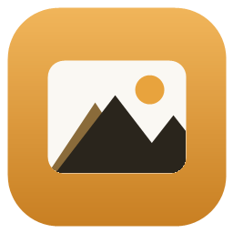
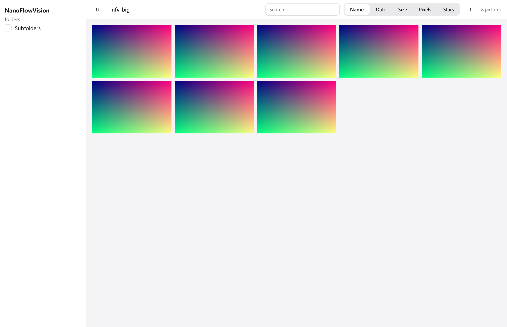
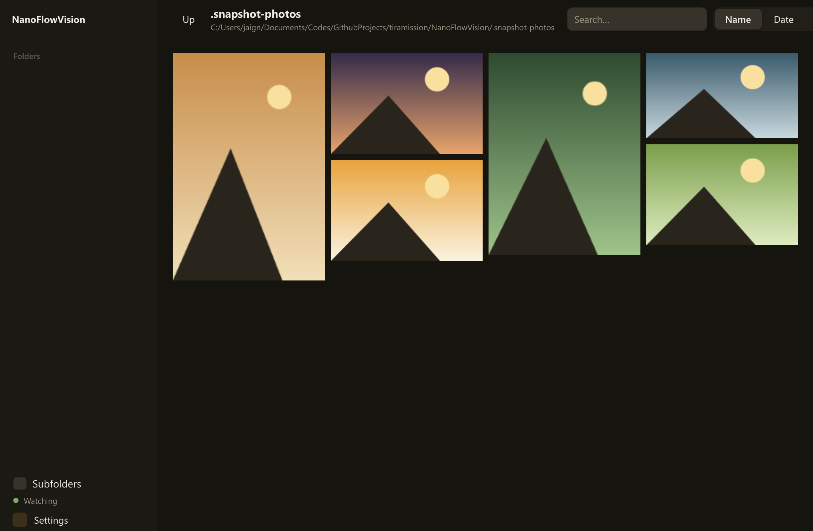
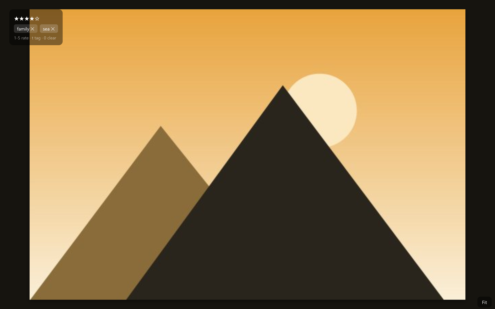

<div align="center">
  <br><br>
</div>

# NanoFlowVision

一个用 [nanoui](https://github.com/justrach/nanoui) 写的图片浏览器：左边是文件夹树，右边是按列排布的瀑布流画廊。Zig 0.17 写成，一个代码库画出三个平台（Windows 用自带渲染器，macOS 用 Metal）。

原项目是 [netdcy/FlowVision](https://github.com/netdcy/FlowVision)（macOS 上的 Swift/AppKit 瀑布流图片浏览器，GPL）。本项目是它的纯 Zig 重写。





## 现在有的东西

- **左侧文件夹树**：点开一个文件夹，它的子文件夹就在下面展开；勾选 Subfolders 把子文件夹的照片一起收进来。
- **打开任意目录**：侧栏下方的“打开目录”起一个系统目录选择框，选中的文件夹成为新的根；上次看的地方下次启动还接着看（命令行参数优先）。
- **瀑布流画廊**：每张照片放进当前最矮的那一列，高度按宽高比算。宽高比只从文件头读，不解码像素，一万个文件也立刻成形。
- **后台解码**：缩略图由工作线程解码，界面不等，没就绪的位置先放一张底色卡片。
- **EXIF 方向**：竖拍的照片立着显示，布局也是竖的。Windows 上 WIC 在解码时做翻转，macOS 上 ImageIO 自带变换。
- **大图观片**：双击打开。滚轮以鼠标为锚缓动缩放（右下角常驻显示比例，适应窗口时明说），放大后可拖拽平移，双击在“适合窗口”和 1:1 之间切换；`←` `→` 走上一张/下一张。
- **信息面板**：大图左上角显示相机、拍摄时间、光圈快门 ISO 焦距，压在深色纱上，盖不住照片。
- **星级与标签写进文件**：大图里按 1–5 打星、按 `t` 加标签，以 XMP 写回照片文件本身——文件挪到哪儿，评分跟到哪儿，Lightroom 也认。
- **文件操作**：复制、粘贴、重命名、移到回收站（走系统回收站，可还原）；在资源管理器中显示。
- **排序与搜索**：按名称/日期/大小/像素数排序，工具栏即输即搜。
- **磁盘监视**：文件夹里新增或删除照片，画廊自己更新。
- **中英界面、深浅两主题**：侧栏底部的设置面板里切换，即时生效、即时持久化；窗口位置和大小下次回来还在。

### 快捷键

| 键 | 作用 |
|---|---|
| 双击照片 | 打开大图；大图里在“适合窗口”和 1:1 间切换 |
| `←` `→` | 大图里上一张 / 下一张 |
| 滚轮 | 大图里缩放（以鼠标为锚） |
| 拖拽 | 大图里平移（放大后） |
| `1`–`5` / `0` | 打星 / 清除星级（写回文件） |
| `t` | 给照片加标签 |
| `Delete` | 把这张照片移到回收站 |
| `Ctrl+D` | 深浅主题切换 |
| `Ctrl+V` | 粘贴剪贴板里的文件 |
| `Esc` | 关闭菜单 / 设置 / 大图 |

照片右上角悬停出现 `⋯`，菜单里有：打开大图、在系统中打开、在资源管理器中显示、复制、重命名、移到回收站。



## 跑起来

需要 Zig 0.17.0。

```sh
zig build                                  # 编译
zig build test                             # 测试（离屏渲染，不弹窗）
zig-out/bin/nanoflowvision.exe             # 打开窗口
zig-out/bin/nanoflowvision.exe D:\Photos   # 直接看某个文件夹
```

不装 `nui` 也能用这些检查方式（nanoui 给 coding agent 准备的）：

```sh
zig-out/bin/nanoflowvision.exe D:\Photos --nanoui-snapshot=shot.png --nanoui-wait=2
zig-out/bin/nanoflowvision.exe D:\Photos --nanoui-dark --nanoui-snapshot=shot-dark.png
```

快照在不弹窗的情况下把界面渲染成 PNG；`--nanoui-script="click:设置;wait:0.5"` 还能按脚本点几步再截。

## 它是怎么做的

| 模块 | 做什么 |
|---|---|
| `src/scan.zig` | 读文件夹：里面的子文件夹和图片 |
| `src/decode.zig` | 只读文件头拿到宽高；解码成 BGRA 预乘像素，EXIF 方向在这里收口 |
| `src/wic.zig` | Windows 的解码器：WIC 边解码边缩放，顺路做 EXIF 翻转 |
| `src/imageio.zig` | macOS 的解码器：ImageIO，同一套约定 |
| `src/masonry.zig` | 算每张照片的位置：最矮的一列先放 |
| `src/thumbs.zig` | 缓存 + 工作线程池，后台解码缩略图 |
| `src/exif.zig` | EXIF 就在量尺寸读过的头部字节里，顺路解析 |
| `src/xmp.zig` | 星级与标签的 XMP 写回：临时文件、原子替换、保留原日期 |
| `src/gallery.zig` | 画廊：工具栏、照片网格、每张照片的 ⋯ 角标 |
| `src/large.zig` | 大图：缩放、平移、信息面板 |
| `src/app.zig` | 状态与视图：树、浮层、设置 |
| `src/win.zig` | Windows 侧的小胶水：窗口图标、最大化状态 |

三个关键决定：

1. **不走 nanoui 的图集，用 `ui.texture` 自己传像素。** nanoui 的 `ui.image` 把图片打进 2048×2048 的图集，最长边截到 1024——大图看不了，而且图集满了会清空重排，滚动时卡顿。`ui.texture` 直接吃 BGRA 像素，没有这些限制。
2. **布局是解析算出来的。** 每张照片的宽高比在布局前就已经知道（只读文件头，不碰像素），所以任意一张照片的位置都能直接算出来，不必先构建它。视口外的照片一个都不构建。
3. **大图不整个进内存。** 有系统解码器的平台上（Windows 的 WIC、macOS 的 ImageIO），照片在解码时就地缩放，一张 24 MP 的照片从不整个坐进内存；别处——以及系统解码器读不了的照片——才整读文件、由 [zigimg](https://github.com/zigimg/zigimg) 出缩略图。

## 还没做的

视频播放、justified/grid 两种布局、画廊的键盘选中与导航、缩略图大小档位。做什么、按什么顺序，每一步的验收标准，见 [ROADMAP.md](ROADMAP.md)。

## 依赖

- [nanoui](https://github.com/justrach/nanoui) v0.6.4 —— UI 框架
- [zigimg](https://github.com/zigimg/zigimg) —— 纯 Zig 的图片解码（JPEG / PNG / BMP / GIF / TIFF / …）
- [nfd-zig](https://github.com/fabioarnold/nfd-zig) —— 系统原生文件/目录对话框

## 协议

nanoui、zigimg 与 nfd-zig 都是 MIT。本项目尚未选定协议。
